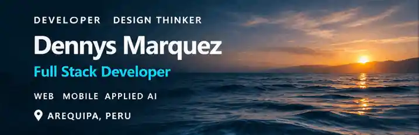

  

   

  
  
  

 

### 👋 Hello, I'm Dennys

I'm a **Full Stack Developer based in Arequipa, Peru**, with a technical degree in **Software Design and Development from TECSUP**.

I enjoy turning complex problems into clear, practical digital experiences — from responsive web platforms to mobile apps and AI-assisted workflows. I care about useful features, thoughtful interfaces, and maintainable code.

- **What I build:** web applications, internal tools, mobile solutions and intelligent experiences.
- **What I value:** simplicity, accessibility, performance and a great user experience.
- **What I'm exploring:** applied AI, automation and digital services that make everyday work easier.

---

### ✦ Featured work

<table>
<tr>
  <td width="50%" valign="top">
    <h3>🇵🇪 <a href="https://ahorratiempo.pe">AhorraTiempo</a></h3>
    
An independent platform that helps people understand and navigate administrative procedures in Peru with AI-assisted guidance.

    
<strong>Focus:</strong> Web platform · AI integration · UX

    <a href="https://ahorratiempo.pe"><strong>Explore live project ↗</strong></a>
  </td>
  <td width="50%" valign="top">
    <h3>🛒 <a href="https://github.com/dennys3mf/mimarket-flutter">MiMarket · Flutter POS</a></h3>
    
A mobile point-of-sale experience for a minimarket, designed around quick sales, inventory tasks and offline-first operation.

    
<strong>Stack:</strong> Flutter · Dart · Firebase

    <a href="https://github.com/dennys3mf/mimarket-flutter"><strong>View repository ↗</strong></a>
  </td>
</tr>
<tr>
  <td colspan="2" valign="top">
    <h3>⛑️ <a href="https://github.com/dennys3mf/Proyecto-Casco-Seguridad-IoT">Smart Safety Helmet · IoT Prototype</a></h3>
    
A technical project exploring operator fatigue detection for heavy machinery using motion sensing, local alerts and cloud monitoring.

    
<strong>Focus:</strong> IoT · Sensors · Safety technology

    <a href="https://github.com/dennys3mf/Proyecto-Casco-Seguridad-IoT"><strong>Explore project ↗</strong></a>
  </td>
</tr>
</table>

### ⚡ Tools & technologies

  

 

**Frontend:** React · TypeScript · JavaScript · Next.js · Tailwind CSS  
**Backend & cloud:** Node.js · Python · Firebase · Cloudflare  
**Mobile & workflow:** Flutter · Dart · Git · GitHub · Figma

---

### 🤝 Let's build something useful

I'm interested in collaborating on products that bring together **good engineering, clear design and meaningful problem-solving**.

If you'd like to discuss an idea, a product or a development opportunity, feel free to reach out.

  <a href="mailto:dennys.marquez.dev@gmail.com"><strong>✉️ Email me</strong></a>
  &nbsp; · &nbsp;
  <a href="https://www.linkedin.com/in/dennys-marquez/"><strong>LinkedIn</strong></a>
  &nbsp; · &nbsp;
  <a href="https://github.com/dennys3mf?tab=repositories"><strong>Explore my repositories</strong></a>
    
  Built with intention. Designed for clarity.

